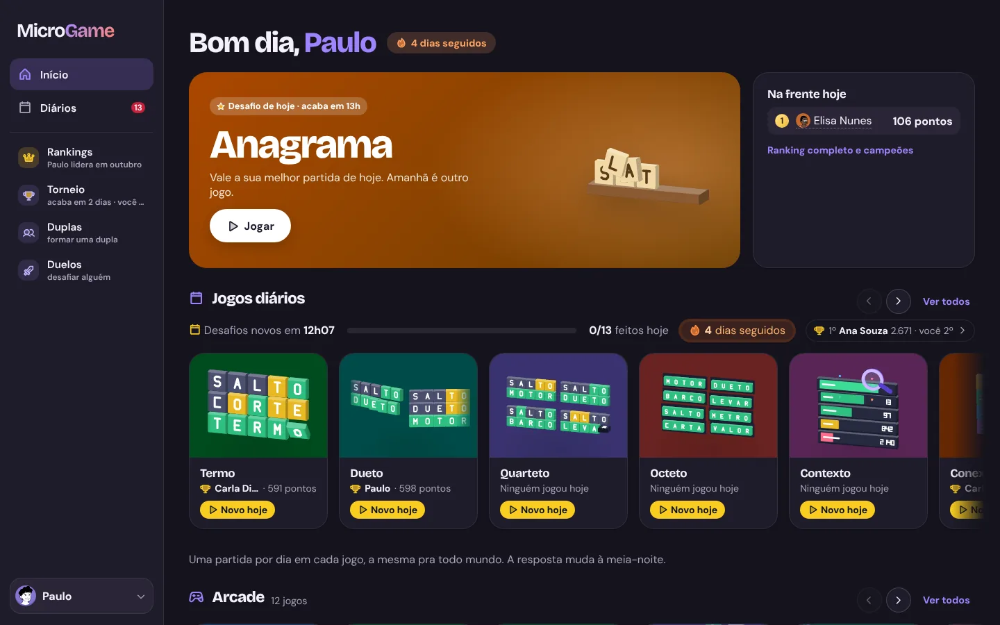
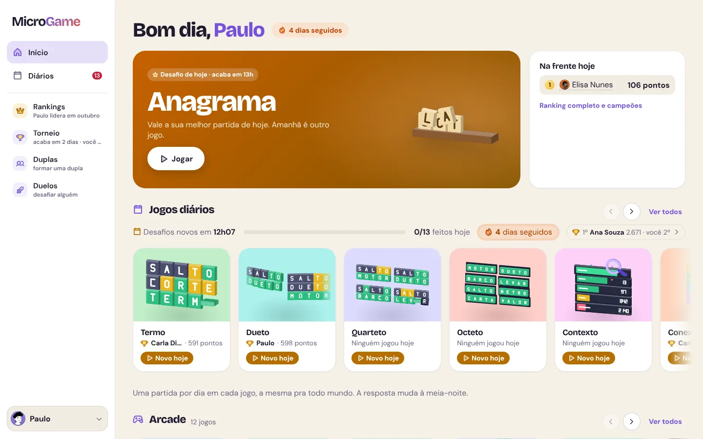
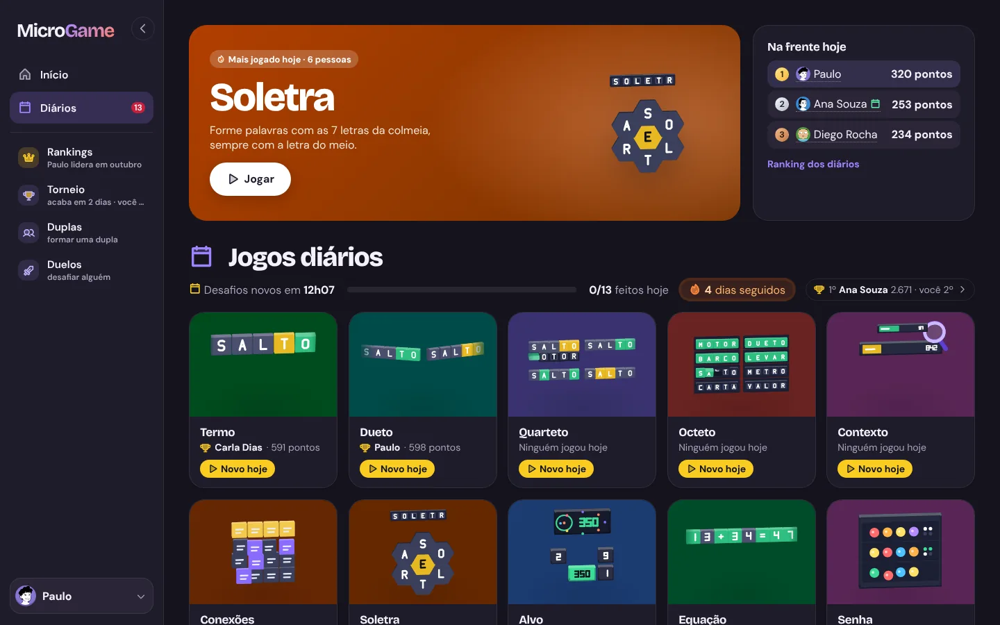
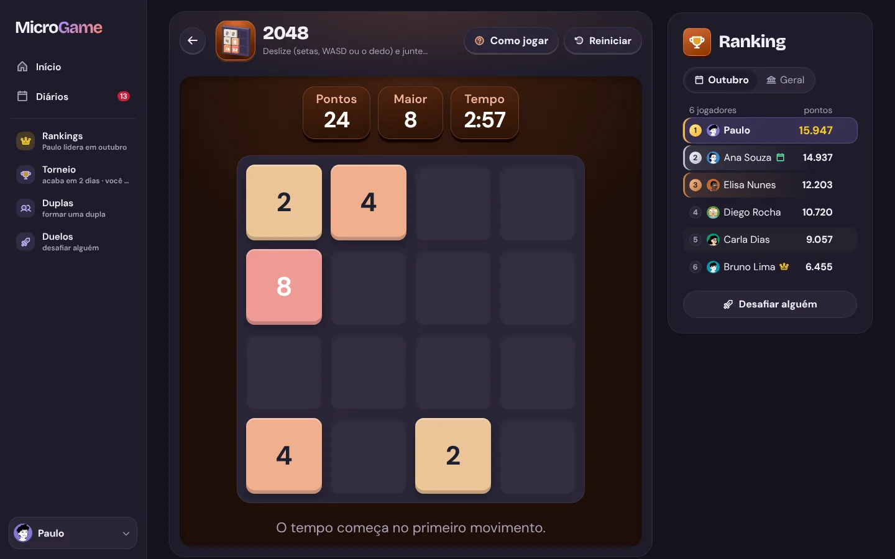
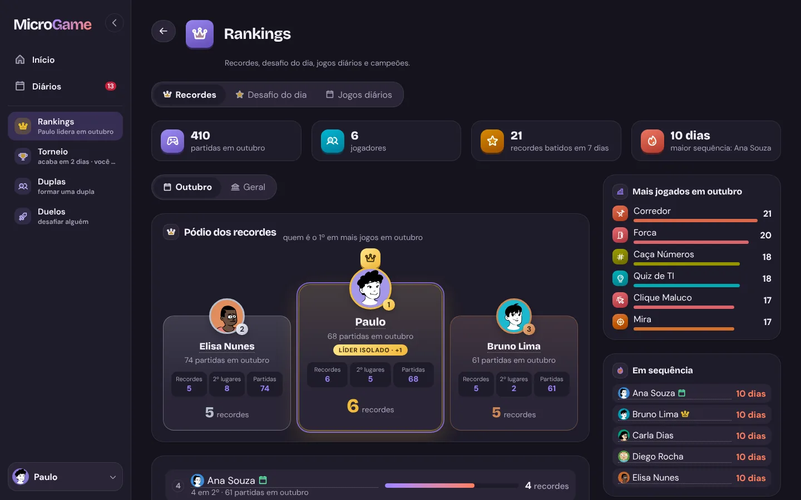
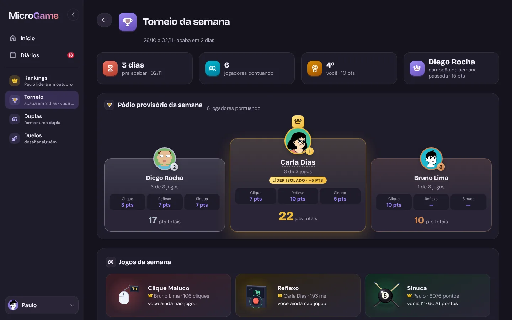
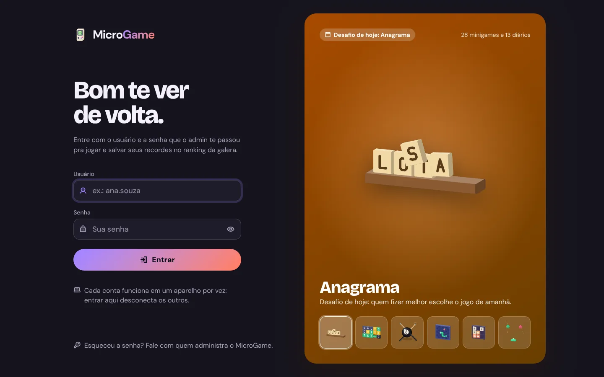
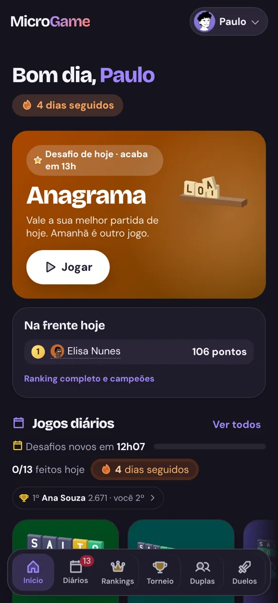
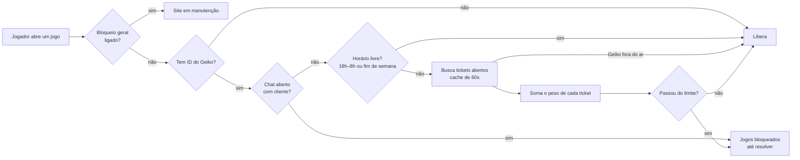
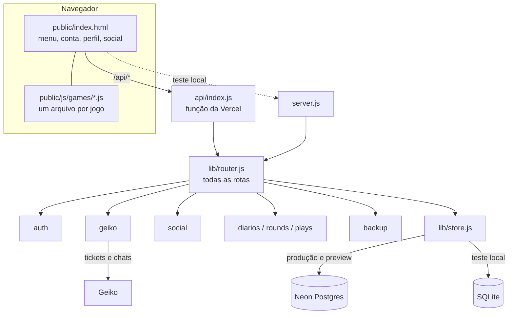

<div align="center">

# 🎮 MicroGame

**41 minigames de navegador pra jogar com o pessoal do trabalho: 28 pra jogar quando quiser e 13 diários.**
Ranking compartilhado, desafio do dia, torneio semanal, duelos, duplas, conquistas e integração com a fila do Geiko.


<br>



</div>

<br>

## 📑 Sumário

- [✨ Destaques](#-destaques)
- [🖼️ Telas](#️-telas)
- [🕹️ Os jogos](#️-os-jogos)
- [🏆 Competição e social](#-competição-e-social)
- [🚦 Login e bloqueio pelo Geiko](#-login-e-bloqueio-pelo-geiko)
- [🐞 Reportar problema (tickets)](#-reportar-problema-tickets)
- [🛠️ Painel admin](#️-painel-admin)
- [🧱 Arquitetura](#-arquitetura)
- [🚀 Rodando no seu PC](#-rodando-no-seu-pc)
- [☁️ Deploy e ambientes](#️-deploy-e-ambientes)
- [🔐 Variáveis de ambiente](#-variáveis-de-ambiente)
- [📜 Scripts](#-scripts)
- [🧪 Testes](#-testes)
- [💾 Backups](#-backups)
- [🗂️ Estrutura de pastas](#️-estrutura-de-pastas)
- [📦 Bibliotecas e créditos](#-bibliotecas-e-créditos)

<br>

## ✨ Destaques

| | |
| --- | --- |
| 🎯 **41 jogos rápidos** | De 10 segundos a poucos minutos por partida, no computador ou no celular (teclado, mouse, toque, deslize ou botões na tela). Antes da 1ª partida de cada jogo aparece um "Como jogar" com 3 passos e as teclas. |
| 🎨 **Visual Recreio** | Tema claro e escuro, menu lateral que recolhe no PC e barra de navegação embaixo no celular. Cada jogo tem uma cena 3D (Zdog) no card e na tela de jogo. |
| 🏅 **Ranking de verdade** | Por jogo, do mês e geral. O servidor confere cada pontuação antes de gravar: nos jogos de arcade a partida é aberta no servidor e vale uma vez só, no relógio dele (`lib/plays.js`); o 2048 é refeito no servidor a partir dos movimentos; as respostas do Termo, Forca, Anagrama, Quiz e dos diários ficam só no servidor; mais a faixa válida de cada jogo e a trava anti-autoclicker. |
| 📅 **Desafio do dia** | Um jogo sorteado por dia, igual pra todo mundo. Quem ganha leva a coroa e escolhe o jogo de amanhã. |
| ⚔️ **Competição** | Telas de Rankings, Torneio semanal, Duplas e Duelos, com pódio, reações nos recordes e avisos. |
| 🎖️ **49 conquistas** | Calculadas na página a partir do histórico de partidas, sem nada extra no banco. Algumas liberam avatares e títulos. |
| 🚦 **Integração com o Geiko** | Quem está com a fila de tickets cheia, ou com chat aberto com cliente, fica sem jogar até resolver. |
| 📱 **Instalável** | No celular ou no Chrome, "Instalar app" põe o MicroGame na tela inicial e abre em tela cheia. |
| ⚡ **Leve** | Sem framework: um arquivo JS por jogo, e a biblioteca de jogos (Phaser) só baixa quando alguém abre um deles. Em PC fraco o site entra sozinho no modo leve (sem 3D nem fundo animado). |

<br>

## 🖼️ Telas

<table>
  <tr>
    <td width="50%"><br><sub><b>Menu no tema claro.</b> O tema fica no menu da conta.</sub></td>
    <td width="50%"><br><sub><b>Diários.</b> 13 jogos, uma partida por dia, com sequência e ranking de hoje.</sub></td>
  </tr>
  <tr>
    <td><br><sub><b>Tela de jogo.</b> O jogo à esquerda e o ranking do mês ou geral à direita.</sub></td>
    <td><br><sub><b>Rankings.</b> Pódio dos recordes, números do mês, mais jogados e sequências.</sub></td>
  </tr>
  <tr>
    <td><br><sub><b>Torneio da semana.</b> Pódio provisório e os 3 jogos da semana.</sub></td>
    <td><br><sub><b>Tela de entrar.</b> Formulário à esquerda e vitrine 3D dos jogos à direita.</sub></td>
  </tr>
</table>

<div align="center">

<br><sub>📱 <b>No celular:</b> uma barra só, embaixo (Início, Diários, Rankings, Torneio, Duplas e Duelos).</sub>
</div>

<br>

## 🕹️ Os jogos

Cada jogo é um arquivo em [`public/js/games/`](public/js/games) (o Dueto, o Quarteto e o Octeto dividem o `dueto.js`). Os marcados com 🎨 usam **Phaser**; os outros são DOM puro. Os jogos Phaser pausam sozinhos quando você troca de aba ou de janela. No menu, os 28 jogos ficam em 3 fileiras, as mesmas de `GAME_CATS` em `public/js/recreio.js`.

### 🕹️ Arcade (12)

| Jogo | Como joga |
| --- | --- |
| **Sinuca** 🎨 | Sinuca de 8 bolas contra a máquina, estilo 8 Ball Pool: arraste pra mirar, puxe o taco pra dar força e escolha o efeito na branca. Encaçape lisas ou listradas e depois a 8. Cada mesa vencida deixa a máquina melhor; perdeu, acabou. |
| **Blocos** 🎨 | Estilo Tetris, com guardar peça (C), girar pros dois lados e 3 próximas. Linhas em peças seguidas sobem o multiplicador até x4; TETRA seguido vale 1,5×. |
| **Cobrinha** 🎨 | Acelera a cada fruta; a dourada vale 5 e a azul encolhe o rabo (−3). Curva antecipada pra responder na hora. |
| **Come-Come** 🎨 | Coma as bolinhas e fuja dos fantasmas; as grandes deixam eles azuis. 3 labirintos que se revezam, cereja bônus, 3 vidas e túnel lateral. |
| **Invasores** 🎨 | Desvie dos tiros e destrua as naves. O tiro é automático; barreiras protegem e a nave-mãe vale bônus. 3 vidas. |
| **Pong** 🎨 | Rebata a bola e passe pela máquina, que acelera a cada ponto. Raquete andando dá efeito na bola. 3 vidas. |
| **Quebra-Tijolos** 🎨 | Rebata a bola e quebre os tijolos: 6 desenhos de fase, tijolos de 1 a 3 batidas e itens (raquete grande, 3 bolas, bola lenta). 3 vidas. |
| **Voa Voa** 🎨 | Passe entre os canos. Aparecem estrela (+3), escudo (aguenta 1 batida) e relógio (câmera lenta). Depois de 20 pontos os canos se mexem. |
| **Corredor** 🎨 | Seja o pássaro mais rápido do deserto: pule cactos e abaixe dos urubus, cada vez mais rápido. Segurar o pulo vai mais alto; moedas valem +25. |
| **Chuva de Bugs** 🎨 | Desvie dos bugs que caem cada vez mais rápido: bug rápido, em zigue-zague e bugão. O café deixa tudo lento por 3s. |
| **Torre** 🎨 | Solte o bloco na torre; o que passa da borda é cortado e os acertos perfeitos aumentam o bloco. |
| **Ritmo** 🎨 | Escolha uma das 5 músicas e aperte D F J K (ou toque na faixa) quando a nota cruzar a linha. Bom 50, Ótimo 100, Perfeito 200; notas compridas e combo. Cada música tem ranking próprio, e o do jogo soma o melhor de cada uma (`lib/ritmo.js`). |

### ⚡ Rapidinhos (8)

| Jogo | Como joga |
| --- | --- |
| **Reflexo** | Clique (ou Espaço) quando ficar verde. Média de 3 rodadas; clicou antes, recomeça. |
| **Clique Maluco** | Quantos cliques em 10 segundos. Tem trava anti-autoclicker no cliente e no servidor. |
| **Mira** 🎨 | Acerte 20 alvos o mais rápido possível. Erro = +0,5s. |
| **Digitação** | Máximo de palavras certas em 30s. |
| **Cor Certa** | Clique na cor da tinta, não no que está escrito (com moldura, vale o que está escrito). Combo até x4; erro zera. |
| **Caça Números** | Clique de 1 a 25 em ordem. A grade só aparece quando você aperta Começar. |
| **Toupeira** | Acerte as toupeiras em 30s. Estrela vale 3, a dourada (rara e rápida) vale 5, bomba tira 3. Combo até x4. |
| **Conta Rápida** | Resolva o máximo de contas em 30s. Combo até x4. |

### 🧠 Pra pensar (8)

| Jogo | Como joga |
| --- | --- |
| **Memória** | Repita a sequência de cores, estilo Genius, com um tom por cor. |
| **Campo Minado** | Abra todas as casas sem mina. O primeiro clique é sempre seguro. |
| **Sudoku** | Menor tempo ganha; dica custa +20s. |
| **2048** | Junte números iguais em 3 minutos ou até travar. |
| **Ligue 4** | Contra a máquina, que fica mais esperta a cada vitória. Vitória rápida rende bônus. |
| **Forca** | Palavras de TI e do escritório, uma atrás da outra. Os erros continuam na próxima palavra (cada acerto tira um); errou 6, acabou. |
| **Quiz de TI** | Mais de 150 perguntas de TI e de escritório, 4 alternativas, 60s. Combo até x4; errou, perde 1 ponto e vê a certa. |
| **Anagrama** | Desembaralhe palavras em 60s com uma dica do tema. Palavra maior vale mais; pular não custa ponto e o botão Letra revela uma letra. |

### 📆 Jogos diários (13)

Uma partida por dia em cada um, o mesmo desafio pra todo mundo. A resposta fica só no servidor (`lib/rounds.js` pro Termo, `lib/diarios.js` pros outros): a página manda cada jogada e recebe o resultado dela, e a pontuação é gravada pelo servidor. Ficam fora do desafio do dia, dos duelos e do torneio.

| Jogo | Como joga |
| --- | --- |
| **Termo** | A palavra do dia: 5 letras, 6 tentativas. Dá pra pôr a letra em qualquer quadrado da linha. |
| **Dueto** | 2 palavras ao mesmo tempo, 7 tentativas. |
| **Quarteto** | 4 palavras ao mesmo tempo, 9 tentativas. |
| **Octeto** | 8 palavras ao mesmo tempo, 13 tentativas. |
| **Contexto** | Descubra a palavra secreta: cada palpite mostra a posição dele numa lista ordenada pelo sentido. A lista vem de vetores de palavras em português (spaCy `pt_core_news_lg`, gerados por `scripts/build-contexto.py` em `lib/data/`), sem API externa. |
| **Conexões** | 16 palavras, 4 grupos escondidos (amarelo fácil … roxo pegadinha). 4 erros e acabou. Grupos em `lib/conexoes.js`. |
| **Alvo** | Chegue no número do dia juntando 6 números com + − × ÷. Uma tentativa; vale o resultado mais perto. |
| **Soletra** | Palavras de 4+ letras com as 7 letras da colmeia, sempre com a do meio; a que usa as 7 vale bônus. Encerra quando quiser. |
| **Senha** | Descubra 4 cores (podem repetir) em 8 tentativas: cada palpite diz quantas estão no lugar e quantas em outro lugar. |
| **Equação** | O Termo com números: a conta do dia (8 símbolos, tipo `12+35=47`) em 6 tentativas; todo palpite tem que ser uma conta certa. |
| **Bandeira** | De que país é a bandeira? 6 palpites; cada erro diz a distância, a direção e o quanto chegou perto. Continente depois de 2 erros, capital depois de 4. |
| **Caça-palavras** | 8 palavras de 2 temas num quadro 10×10, em qualquer direção. Mais rápido, mais pontos. |
| **Cruzadinha** | Mini palavras cruzadas 5×5 com dicas. A grade cheia é enviada sozinha; conferir marca os erros mas tira 60 pontos. Mais rápido, mais pontos. |

Os dados vêm de scripts que rodam uma vez, fora do app: `scripts/build-diarios.js` (Bandeira e Soletra), `scripts/build-soletra.py`, `scripts/build-contexto.py` e `scripts/build-cruzadinha.js` (grades a partir de `lib/data/cruzadinha-dicas.txt`).

Na aba Diários:
- 🏁 **Ranking de hoje**: soma os pontos de todos os diários do dia e zera à meia-noite (cada diário também tem ranking só do dia). Os diários ficam fora de recordes, campeões do mês e duplas.
- 👑 **Campeão dos diários**: quem fecha o dia em 1º no Ranking de hoje ganha um selo ao lado do nome no dia seguinte (com confete) e libera a moldura *Aurora*.
- 🔥 **Sequência**: dias seguidos jogando pelo menos um diário. Aparece no menu (com o contador de diários que faltam no menu lateral) e no perfil, com o recorde; 7 dias liberam a moldura *Brasa*.
- 📤 **Compartilhar meu dia**: um resumo com os pontos, a posição, a sequência e o que foi jogado (no celular abre o compartilhar do sistema; no PC copia).
- ⏰ **Lembrete**: a partir das 18h, se ainda falta jogar algum, uma faixa avisa quanto tempo falta pra virar o dia.

<br>

## 🏆 Competição e social

Quase tudo sai das **partidas** (tabela `scores`): só o que não dá pra deduzir delas ganha tabela própria. O menu mostra só o líder do desafio de hoje e o recorde em cada card; o resto fica nas telas **Rankings**, **Torneio**, **Duplas** e **Duelos** do menu lateral (ou da barra de baixo no celular). Cada uma abre com 4 números do período e um pódio (1º no centro, 2º à esquerda, 3º à direita).

### 📅 Desafio do dia
- Um jogo por dia, sorteado de forma determinística (`public/js/daily.js`, usado pela página e pelo servidor, então os dois sempre concordam). A cada ciclo passa por todos os jogos numa ordem embaralhada. Jogo novo só entra a partir do dia em que foi lançado.
- Vale a melhor partida do dia. Quem ganha:
  - 👑 leva a **coroa** ao lado do nome no dia seguinte, com aviso de parabéns e confete;
  - 🎯 **escolhe o jogo de amanhã**;
  - 🖼️ acumula vitórias que liberam **molduras de avatar**:

| Moldura | Desafios ganhos |
| --- | --- |
| 🥉 Bronze | 1 |
| 🥈 Prata | 3 |
| 🥇 Ouro | 7 |
| 💎 Diamante | 15 |

### 🏅 Rankings
Abas **Recordes**, **Desafio do dia** e **Jogos diários**, cada uma com Mês ou Geral. Mostra o pódio de quem tem mais 1º lugares, a lista do 4º em diante, os mais jogados do mês, as maiores sequências, os campeões dos meses que já acabaram e, se o Geiko estiver configurado, o destaque de tickets resolvidos na semana.

🏅 **Campeão do mês:** quem termina o mês com mais recordes de 1º lugar ganha um selo fixo, uma medalha ao lado do nome em todos os rankings (com o número, se ganhou mais de uma vez) e o título *Campeão de setembro de 2026* no perfil.

### 🗓️ Torneio semanal
- Semana de segunda a domingo, no horário de Brasília. Cada semana sorteia **3 jogos**, iguais pra todo mundo, e a soma das posições vira pontos.
- Pontos por posição em cada jogo: **10, 7, 5, 4, 3, 2** do 1º ao 6º, e **1 ponto** do 7º em diante.
- A tela mostra o pódio provisório, os pontos de cada pessoa em cada jogo e os 3 jogos da semana com a cena 3D.
- Os jogos diários não entram (só vale 1 partida por dia). Os 3 jogos da semana ficam guardados, então não mudam se entrar jogo novo no meio.

### ⚔️ Duelos
Desafie alguém num jogo. O duelo dura **24h**, com no máximo **5 abertos** por pessoa. Nos últimos resultados tem o botão **Revanche** (mesmo jogo, mesma pessoa, num toque), e o aviso de duelo encerrado já abre com a revanche preenchida.

### 🤝 Duplas
Duas pessoas formam uma dupla com o nome que quiserem. Quem convida escolhe o nome (2 a 24 caracteres); o convidado tem **48h** pra aceitar ou recusar. Cada pessoa só pode estar numa dupla (ou convite aberto) por vez, e a pontuação da dupla é calculada na página a partir das partidas. A tela mostra uma matriz jogo × dupla com medalhas. Quando alguém da dupla toma o 1º lugar (geral ou do mês) de outra pessoa num jogo, o parceiro recebe um aviso.

### 👏 Reações e avisos
- Reaja ao recorde de alguém direto na linha do ranking.
- O sino avisa quando alguém **toma seu recorde**, reage, te desafia, quando o torneio muda ou quando um ticket seu foi respondido.

### 🎖️ Perfil e conquistas
Clique no nome de qualquer pessoa pra abrir o perfil: avatar, moldura, título, uma frase curta, resumo de partidas e as conquistas. São **49 conquistas**, como *Estreia*, *Explorador* (10 jogos diferentes), *Zerou o menu*, *Rei de um jogo*, *Campeão da semana*, *Tricampeão*, *Dobradinha*, *Constância* (5 dias úteis seguidos), *Madrugador*, *Hora do almoço*, *Veterano* (500 partidas) e *Lenda da firma* (1000 partidas). Tudo é calculado na página a partir do ranking (`public/js/profile.js`).

Os **avatares** são desenhos (DiceBear e game-icons.net) salvos em `public/img/avatars/`, com 9 cores de fundo. Alguns liberam com uma conquista, e cada jogo tem um avatar próprio que libera depois da 1ª partida.

<br>

## 🚦 Login e bloqueio pelo Geiko



- Cada pessoa tem **conta própria**: senha com scrypt, sessão em cookie httpOnly com JWT assinado com `SESSION_SECRET`. O nome no ranking é o da conta, e no primeiro login a pessoa troca a senha temporária. Muitas senhas erradas seguidas travam o login por um tempo.
- **Uma conta = um aparelho:** cada login grava um `session_id` novo e derruba a sessão anterior. A página confere a cada 20s (`/api/auth/ping`) e mostra o aviso.
- Contas com **ID do Geiko** vinculado têm os jogos bloqueados quando a fila passa do limite. Quem não tem ID do Geiko nunca é bloqueado, e se o Geiko cair a regra libera em vez de travar todo mundo.
- **Horário livre:** das 18h às 8h (horário de Brasília) nos dias úteis e o sábado e domingo inteiros, ninguém é bloqueado pela fila, mesmo com ticket aberto. O selo continua mostrando a fila, e o bloqueio manual do admin continua valendo nesse horário.
- A consulta de tickets é a mesma do GeikoDashboard: `POST /attendance/search` com `attendantIds` + `openAttendance`.
- **Chat aberto com cliente também bloqueia**, até no horário livre. A API pública não tem isso, então o servidor lê o mesmo serviço do Monitor Chat (`wschat.geiko.com.br`, sem chave): `GET /attendant/allAttendants` acha a pessoa pelo ID do Geiko (ou pelo nome de usuário) e `GET /attendances` traz os chats abertos dela. Empresa e sala ficam no painel admin (padrão 94 e 1); se o chat cair, libera. O selo mostra "Em chat" e o aviso lista os clientes.
- **Bloqueio geral (manutenção):** a conta dona liga no painel admin, com motivo e duração (de 15 min a 4 h, até o fim do dia ou até liberar). Todo mundo menos ela, admins incluídos, vê "Site em manutenção". Fica na tabela `settings` (`lib/sitelock.js`), então vale na hora sem deploy.
- **A regra da fila é editável no painel admin** e fica na tabela `settings`. Os valores padrão (`lib/geiko.js`):

| Parâmetro | Padrão | O que faz |
| --- | --- | --- |
| Limite | `3` | Bloqueia quando a soma dos pesos passa disso. |
| Peso por prioridade | `URG 2` · `ALT 1,5` · `MED 1` · `NOR 1` · `BAI 0,75` · sem prioridade `2,5` | Quanto cada ticket pesa. |
| Sem interação | `× 1,5` | Ninguém mexeu desde a abertura, ou tem mensagem nova sem resposta. |
| Aguardando cliente | `× 0,25` | Já interagiu e está esperando retorno do cliente. |
| Horário livre | ligado · `18h` às `8h` · fim de semana | Fora desse horário a fila bloqueia; dentro dele libera todo mundo. |
| Chat | ligado · empresa `94` · sala `1` | Chat aberto com cliente bloqueia, até no horário livre. |

- O **selo da fila** fica ao lado da conta. Bloqueado, ele diz o menor número de tickets que, resolvidos, liberam; liberado, quanto ainda cabe na fila antes de bloquear.

<br>

## 🐞 Reportar problema (tickets)

- No menu da conta, **Reportar problema** abre uma tela com o formulário (tipo: algo quebrou, problema num jogo, minha conta, sugestão ou outra coisa), até 3 imagens (reduzidas no navegador) e a lista **Seus tickets**. Cada pessoa manda até 10 por dia.
- Só a conta dona lê os tickets, em **Administração > Tickets**, com o contador de abertos. Ela responde (com até 3 imagens) e resolve; quem mandou recebe um aviso e vê a resposta em Seus tickets.
- Tabelas `tickets` e `ticket_images`. Os tickets não entram no backup.

<br>

## 🛠️ Painel admin

Só pra contas com papel de admin:

- ⛔ **Bloqueio geral:** liga e desliga o modo manutenção (só a conta dona).
- 🟢 **Quem está online.**
- 👥 **Contas:** criar, editar, desativar, vincular ID do Geiko, liberar ou bloquear manualmente, apagar a frase do perfil de alguém.
- 🤝 **Duplas:** ver as duplas e montar uma dupla manualmente.
- 🚦 **Regra de bloqueio do Geiko:** limite, pesos, multiplicadores, horário livre e chat, mais um teste de ID do Geiko.
- 📝 **Respostas do dia:** as respostas dos jogos diários de um dia e o que cada pessoa mandou.
- 📊 **Relatório:** partidas por pessoa × jogo, por dia e por hora.
- 🧑‍💻 **Jogo × trabalho:** na semana, quantas partidas cada pessoa jogou comparado aos tickets que fechou e à fila atual.
- ✏️ **Editor de recordes:** só a conta dona (`RECORDS_OWNER`) mexe em recorde, mesmo sendo admin. Dá pra apagar uma partida, zerar o ranking de um jogo ou todos os pontos de uma pessoa.
- 🐞 **Tickets:** os problemas reportados (só a conta dona).
- 💾 **Backups:** baixar, importar e restaurar.
- 🐛 **Erros de JavaScript** dos jogadores (no máximo 5 por página, sem repetir).

<br>

## 🧱 Arquitetura



A ideia central é que **o código das rotas é um só** (`lib/router.js`): a Vercel e o servidor local usam o mesmo, então o que você testa no PC é exatamente o que vai pra produção. Só o banco muda, e o `lib/store.js` dá a mesma API pra Neon e SQLite (as consultas são escritas no SQL comum aos dois).

No front não tem framework: cada arquivo de `public/js/` é um script comum carregado pelo `index.html`. No deploy, `npm run build` junta tudo num arquivo só com o esbuild.

### 🔌 Rotas da API

| Grupo | Rotas |
| --- | --- |
| Sessão | `/api/auth/login` · `logout` · `me` · `password` · `ping` |
| Jogo | `/api/scores` · `/api/plays` · `/api/gate` · `/api/version` |
| Respostas no servidor | `/api/termo` · `/api/termo/guess` · `/api/rounds` · `/api/diarios` · `/api/ritmo` · `/api/ritmo/score` |
| Competição | `/api/social` · `/api/reactions` · `/api/duels` · `/api/duos` |
| Prêmios e perfil | `/api/daily/pick` · `/api/flair` · `/api/profile/frame` · `/api/profile/look` |
| Avisos | `/api/notifications` · `/api/notifications/read` |
| Tickets | `/api/tickets` · `/api/tickets/image` |
| Geiko | `/api/geiko/week` |
| Telemetria | `/api/vitals` · `/api/errors` |
| Admin | `/api/admin/users` · `rules` · `site-lock` · `records` · `records/clear` · `records/delete` · `report` · `workplay` · `backups` · `errors` · `online` · `duos` · `bio` · `daily-answers` · `tickets` · `preview` |
| Infra | `/api/cron/backup` · `/api/homolog/bootstrap` (só nos previews) |

### 🗃️ Tabelas

`scores` · `users` · `settings` · `notifications` · `client_errors` · `reactions` · `duels` · `duos` · `termo_plays` · `daily_plays` · `game_rounds` · `arcade_plays` · `ritmo_scores` · `login_fails` · `backups` · `tickets` · `ticket_images` (criadas e atualizadas de forma idempotente por `lib/schema.js`).

<br>

## 🚀 Rodando no seu PC

Precisa de **Node 22 ou mais novo** (o banco local usa `node:sqlite`).

```bash
git clone https://github.com/PainN04/MicroGames.git
cd MicroGames
npm install

# cria o primeiro admin no banco local e mostra a senha temporária (uma vez só)
npm run admin -- meuusuario "Meu Nome"

# sobe o servidor de teste (SESSION_SECRET com 32+ caracteres, se não estiver no .env.local)
SESSION_SECRET=um-segredo-qualquer-com-32-caracteres npm run local   # http://localhost:8080
```

Pra mudar a porta, defina `PORT` antes (no PowerShell: `$env:PORT=3000`). O servidor de teste:

- usa **SQLite** em `microgame.db`, nunca o banco de produção;
- do `.env.local` só lê o que precisa (chave do Geiko e segredo de sessão). O `DATABASE_URL` de lá é o banco de **produção** e fica de fora de propósito;
- serve a pasta `public/` (os scripts originais, pra testar sem montar): `lib/` e `scripts/` nunca saem. Com `MICROGAME_DIST=1` serve a `dist/` montada pelo `npm run build`, igual à que vai pro ar.

<br>

## ☁️ Deploy e ambientes

| Ambiente | Branch | Banco | Como publica |
| --- | --- | --- | --- |
| **Produção** | `main` | Neon (`DATABASE_URL`) | Cada push na `main` publica sozinho na Vercel. |
| **Teste** | `dev` | Neon de teste (`Homolog_DB_DATABASE_URL`) | A Vercel publica a `dev` a cada push. É onde as mudanças são testadas antes de ir pra `main`. |
| **Preview** | branches de PR | Neon de teste | A Vercel gera um preview por branch (o login não funciona nos previews de PR). |
| **Local** | qualquer | SQLite (`microgame.db`) | `npm run local` |

- Toda mudança entra na `dev` por PR; a `main` só recebe o que já foi testado na `dev`.
- `vercel.json` roda o `npm run build`, publica a `dist/`, manda todo `/api/*` pra função única `api/index.js` (limite de 30s), agenda o cron diário de backup e define os cabeçalhos de segurança (CSP, HSTS, X-Frame-Options).
- Com o banco de teste vazio, `GET /api/homolog/bootstrap` cria o admin dono e mostra a senha temporária uma vez. Só existe nos previews e só enquanto não há nenhuma conta.
- O `GET /api/scores` manda um `ETag`: se o ranking não mudou desde a última abertura do menu, o servidor responde só `304` e o navegador usa a cópia que já tem.
- A página recarrega sozinha quando o `index.html` muda no servidor, só no menu e nunca no meio de uma partida.

<br>

## 🔐 Variáveis de ambiente

Ficam no `.env.local` (teste, fora do Git) e no projeto da Vercel (produção e preview).

| Variável | Obrigatória | Pra quê |
| --- | :---: | --- |
| `DATABASE_URL` | produção | Banco Neon de produção. |
| `Homolog_DB_DATABASE_URL` | preview | Banco Neon das versões de teste. |
| `SESSION_SECRET` | ✅ | Assina a sessão. Mínimo de 32 caracteres; sem ela o login dá erro. |
| `SESSION_TTL_HOURS` | | Duração da sessão em horas (padrão `12`). |
| `GEIKO_API_KEY` · `GEIKO_API_URL` | | Acesso à API do Geiko. Sem elas o bloqueio por fila fica desligado. |
| `RECORDS_OWNER` | | Usuário da conta dona, a única que edita recordes, lê tickets e liga o bloqueio geral (padrão `paulo`). |
| `CRON_SECRET` | produção | Protege o cron diário de backup da Vercel. |
| `PORT` | | Porta do servidor local (padrão `8080`). |
| `MICROGAME_DIST` | | `1` faz o servidor local servir a `dist/` em vez da `public/`. |

> ⚠️ Nunca commite `.env*`, `*.db`, backups (`*backup*.json`) nem `contas-*.csv`: eles têm senhas e nomes do pessoal. Tudo isso já está no `.gitignore`.

<br>

## 📜 Scripts

| Comando | O que faz |
| --- | --- |
| `npm run local` | Servidor de teste local com SQLite. |
| `npm run build` | Monta a `dist/` que a Vercel publica: todos os scripts num arquivo só, dentro de uma função (nada no `window` pra chamar pelo console), ofuscado e minificado, sem source map e sem os arquivos originais. A Vercel roda sozinha no deploy. |
| `npm test` | Checagem do front e os testes com `node --test`. |
| `npm run admin -- <usuario> "<Nome>" [idGeiko]` | Cria ou promove um admin e mostra uma senha temporária. Banco local por padrão; `--producao` usa o da Vercel e `--homolog` o de teste. |
| `npm run importar -- "<.env do GeikoDashboard>" [--producao]` | Cria uma conta por atendente do GeikoDashboard (só leitura lá), já com o ID do Geiko. As senhas temporárias vão pra um `contas-*.csv` fora do Git. Pula quem já tem conta. |
| `npm run migrate` | Copia as pontuações do `microgame.db` pro Neon. Roda uma vez só e se recusa se o Neon já tiver pontuações. |

<br>

## 🧪 Testes

```bash
npm test
```

Roda duas coisas:

1. `scripts/check-front.js` confere a sintaxe de cada script da página e de todos juntos (declaração repetida entre arquivos dá erro).
2. **89 testes** com `node --test` em `test/`:

| Arquivo | O que testa |
| --- | --- |
| `api.test.js` | As rotas da API num banco SQLite temporário: login, pontuações, anti-trapaça, diários, social, admin, tickets e bloqueios. |
| `build.test.js` | A `dist/` montada pelo `npm run build` e o CSP do `vercel.json` (nada de script inline fora dos hashes). |
| `sinuca.test.js` | A física e as regras da Sinuca. |
| `termo-front.test.js` · `equacao-front.test.js` | O teclado e o preenchimento das linhas do Termo e da Equação. |

<br>

## 💾 Backups

Os recordes e as contas têm cópia numa tabela do próprio banco (`backups`), pra proteger contra apagar ou editar por engano:

- uma cópia **por dia** (cron da Vercel às 9h UTC em `/api/cron/backup`, mais uma conferência preguiçosa no `POST /api/scores`);
- uma cópia **antes de cada edição de recordes**;
- só as 30 mais novas são mantidas.

No painel admin dá pra baixar o JSON, importar ou restaurar as partidas de qualquer cópia. Restaurar não ressuscita sessões ativas de ninguém.

<br>

## 🗂️ Estrutura de pastas

```
.
├── api/index.js           única função da Vercel; repassa pro router
├── lib/
│   ├── router.js          todas as rotas /api/*
│   ├── store.js           banco: Neon ou SQLite, mesma API
│   ├── schema.js          cria e atualiza as tabelas
│   ├── auth.js            senhas, sessão e contas
│   ├── geiko.js           bloqueio por fila e por chat do Geiko
│   ├── sitelock.js        bloqueio geral (manutenção)
│   ├── rules.js           faixas de pontuação válidas e anti-autoclicker
│   ├── plays.js           partidas de arcade abertas no servidor (uso único, relógio do servidor, 2048 refeito)
│   ├── rounds.js          Termo, Forca, Anagrama e Quiz com a resposta só no servidor
│   ├── words.js           palavras e perguntas desses jogos
│   ├── diarios.js         os outros jogos diários
│   ├── conexoes.js        grupos do Conexões
│   ├── ritmo.js           músicas e ranking por música do Ritmo
│   ├── social.js          reações, duelos, torneio e duplas
│   ├── flair.js           prêmios do desafio do dia
│   ├── backup.js          cópias de segurança no banco
│   ├── vitals.js          recebe as métricas do web-vitals
│   └── data/              dados gerados dos diários (Bandeira, Soletra, Contexto, Cruzadinha)
├── public/
│   ├── index.html         a página
│   ├── style.css          estilos base
│   ├── recreio.css        o visual Recreio (claro/escuro, menu lateral, telas de competição)
│   ├── js/
│   │   ├── games/         um arquivo por jogo
│   │   ├── core.js        placar, sessão e tela de jogo
│   │   ├── app.js         menu, ranking, conta e avisos
│   │   ├── recreio.js     menu lateral, fileiras de jogos e tema
│   │   ├── login.js       tela de entrar
│   │   ├── howto.js       "Como jogar" e contagem antes da partida
│   │   ├── daily.js       sorteio do desafio do dia (cliente e servidor)
│   │   ├── flair.js       coroa, molduras e escolha do jogo de amanhã
│   │   ├── profile.js     perfil e conquistas
│   │   ├── avatars.js     lista de avatares (cliente e servidor)
│   │   ├── social.js      telas de Rankings, Torneio, Duplas e Duelos
│   │   ├── tickets.js     reportar problema
│   │   ├── admin.js       painel admin
│   │   ├── cards3d.js     cenas 3D dos cards
│   │   ├── stageart.js    arte de fundo da tela de jogo
│   │   ├── icons.js       ícones embutidos
│   │   ├── perf.js        modo leve pra PC fraco
│   │   └── main.js        web-vitals, app instalável e recarga automática
│   ├── data/              palavras válidas do Termo e notas do Ritmo
│   ├── audio/             músicas do Ritmo
│   ├── img/avatars/       avatares
│   ├── fonts/             fontes (Bricolage Grotesque, DM Sans e Space Grotesk)
│   ├── icons/             ícone do app
│   └── vendor/            Phaser, Zdog e Vanilla-Tilt
├── scripts/               build, admin, importação, migração, checagem do front e geradores de dados
├── test/                  testes (node --test)
├── docs/img/              capturas de tela deste README
├── server.js              servidor de teste local
└── vercel.json            build, rotas, cron, limites da função e cabeçalhos
```

A pasta `.claude/` e as pastas `design/`, `production/` e `studio-tests/` são do Claude Code Game Studios (agentes, skills e regras usados pra desenvolver o projeto) e não fazem parte do site.

<br>

## 📦 Bibliotecas e créditos

Phaser, Zdog e Vanilla-Tilt ficam no próprio site (`public/vendor/`, com o jsdelivr de reserva); só o web-vitals vem por CDN.

| Biblioteca | Pra quê |
| --- | --- |
| [Phaser 3.90](https://phaser.io) | Os 13 jogos marcados com 🎨. Servido de `public/vendor/phaser.min.js` (MIT); se o arquivo local falhar, tenta o jsdelivr. Só baixa quando alguém abre um deles (no menu fica pré-buscado em segundo plano). |
| [Zdog 1.1](https://zzz.dog) e [Vanilla-Tilt 1.8](https://micku7zu.github.io/vanilla-tilt.js/) | Cenas 3D e inclinação com brilho dos cards do menu, da tela de entrar e da tela de jogo. Carregam depois que o menu aparece e ficam de fora no modo leve. |
| [web-vitals 6](https://github.com/GoogleChrome/web-vitals) | Mede LCP, INP, CLS, FCP e TTFB de quem joga e manda pra `/api/vitals`. Local: aparece no terminal do `server.js`. Vercel: em Logs do projeto (linhas `[web-vitals]`). |
| [Phosphor Icons](https://phosphoricons.com) (MIT) | Os ícones (traço bold com o fundo do duotone) estão embutidos em `public/js/icons.js`, sem biblioteca nem requisição. Os ícones dos jogos que o Phosphor não tem foram desenhados no mesmo estilo. |
| [DiceBear](https://www.dicebear.com) e [game-icons.net](https://game-icons.net) | Avatares do perfil, salvos como SVG em `public/img/avatars/`. DiceBear: Lorelei, Open Peeps e Pixel Art (CC0) e Bottts (Pablo Stanley, uso livre). Avatares de jogo: game-icons.net (Lorc, Delapouite e outros, [CC BY 3.0](https://creativecommons.org/licenses/by/3.0/)). O macaco é desenho próprio. |
| Músicas de [Kevin MacLeod](https://incompetech.com) (CC BY 4.0) | As 5 músicas do Ritmo (Big Rock, Cool Rock, Neolith, Exhilarate e Metalmania), em `public/audio/ritmo/`, com os créditos em `public/data/ritmo/songs.json`. |
| Fontes [Bricolage Grotesque](https://fonts.google.com/specimen/Bricolage+Grotesque), [DM Sans](https://fonts.google.com/specimen/DM+Sans) e [Space Grotesk](https://fonts.google.com/specimen/Space+Grotesk) (OFL) | Servidas de `public/fonts/`. |
| [world-countries](https://github.com/mledoze/countries) (ODbL) e [flag-icons](https://github.com/lipis/flag-icons) (MIT) | Países, capitais, coordenadas e bandeiras do Bandeira, em `lib/data/bandeiras.json`. |
| Dicionário pt-BR do [LibreOffice](https://github.com/LibreOffice/dictionaries/tree/master/pt_BR) (VERO, MPL 2.0 / LGPL 3) | As palavras do Soletra (`lib/data/soletra.json`) e as de 5 letras aceitas como tentativa no Termo (`public/data/termo-validas.txt`). |
| Vetores de palavras do [spaCy](https://spacy.io) `pt_core_news_lg` (CC BY-SA 4.0) e lista de frequência [FrequencyWords](https://github.com/hermitdave/FrequencyWords) (CC BY-SA 4.0) | Vocabulário e proximidade de sentido do Contexto, em `lib/data/`. |

No servidor, as únicas dependências são [`@neondatabase/serverless`](https://github.com/neondatabase/serverless) e [`jose`](https://github.com/panva/jose). No build, [esbuild](https://esbuild.github.io) e [javascript-obfuscator](https://github.com/javascript-obfuscator/javascript-obfuscator).

<br>

<div align="center">

Feito pra dar uma pausa no meio do expediente. ☕🎮

</div>
