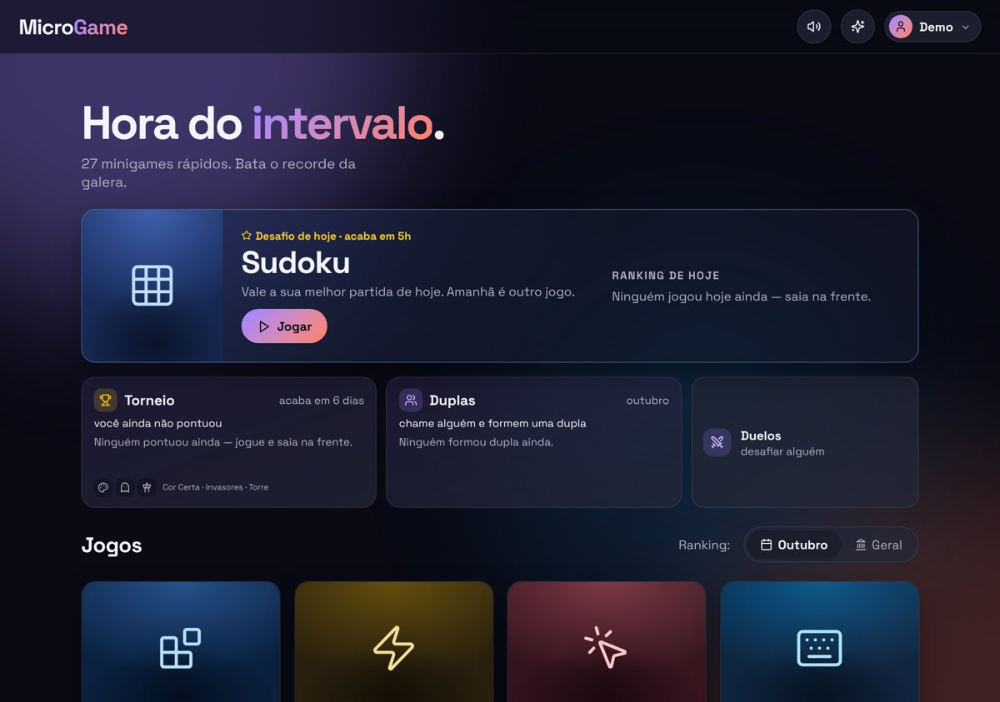
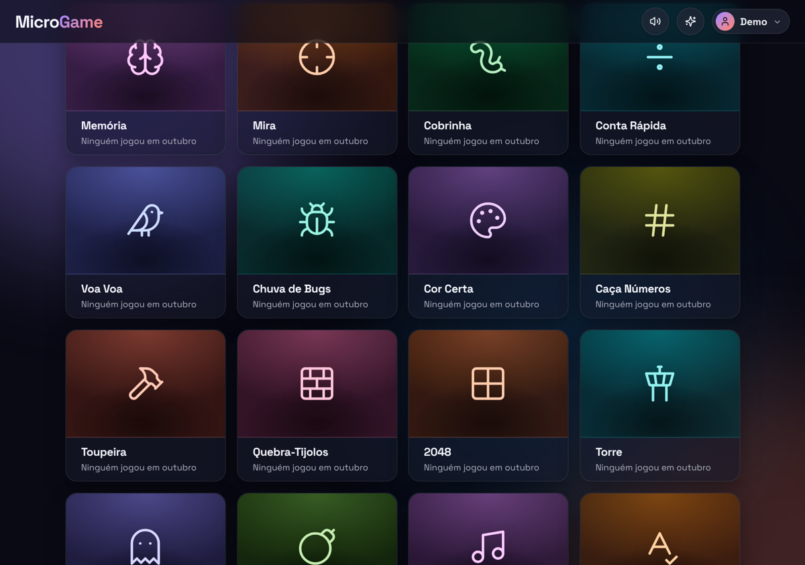
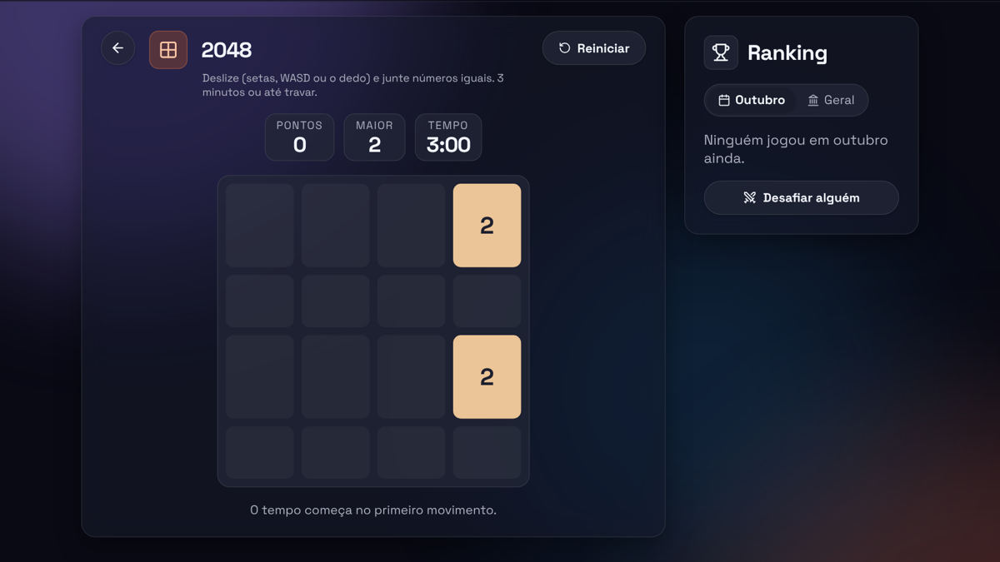
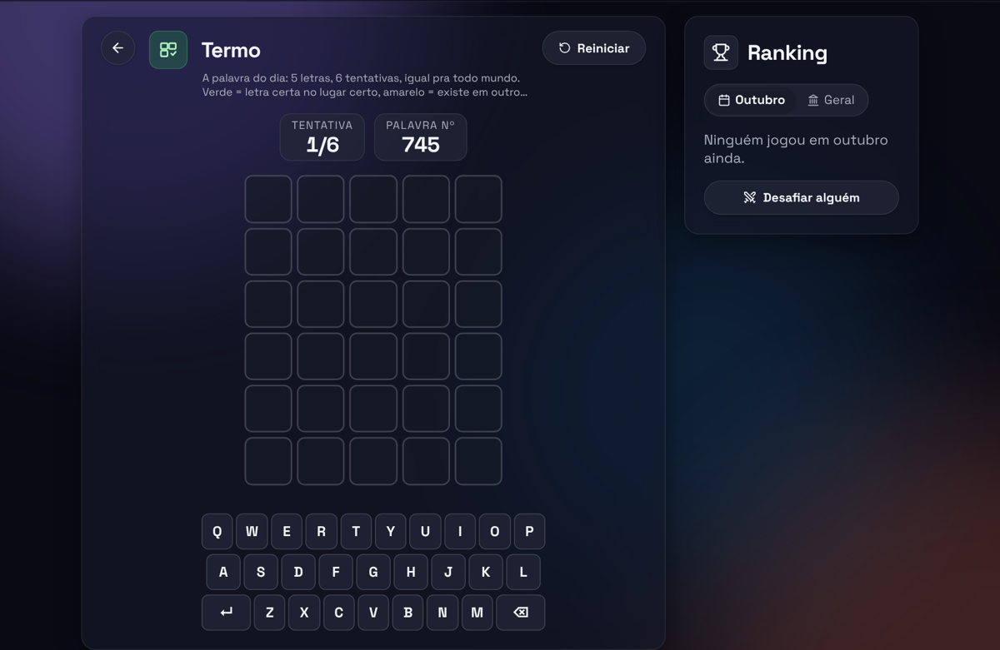
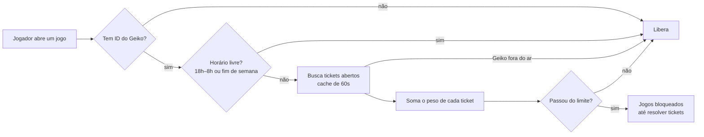
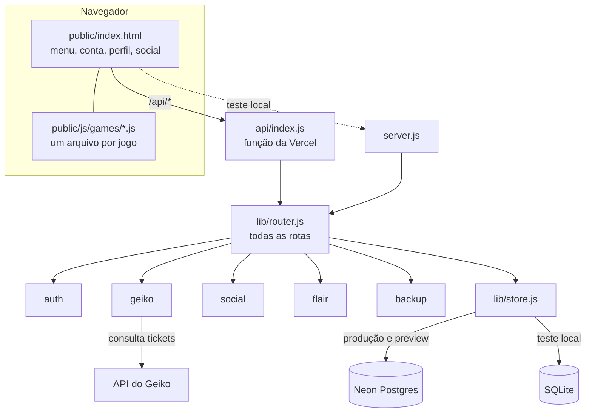

<div align="center">

# 🎮 MicroGame

**28 minigames de navegador pra jogar com o pessoal do trabalho.**
Ranking compartilhado, desafio do dia, torneio semanal, duelos, duplas e conquistas.


<br>



</div>

<br>

## 📑 Sumário

- [✨ Destaques](#-destaques)
- [🕹️ Os 28 jogos](#️-os-28-jogos)
- [🏆 Competição e social](#-competição-e-social)
- [🚦 Login e bloqueio por fila do Geiko](#-login-e-bloqueio-por-fila-do-geiko)
- [🛠️ Painel admin](#️-painel-admin)
- [🧱 Arquitetura](#-arquitetura)
- [🚀 Rodando no seu PC](#-rodando-no-seu-pc)
- [☁️ Deploy e ambientes](#️-deploy-e-ambientes)
- [🔐 Variáveis de ambiente](#-variáveis-de-ambiente)
- [📜 Scripts](#-scripts)
- [🧪 Testes](#-testes)
- [💾 Backups](#-backups)
- [🗂️ Estrutura de pastas](#️-estrutura-de-pastas)
- [📦 Bibliotecas](#-bibliotecas)

<br>

## ✨ Destaques

| | |
| --- | --- |
| 🎯 **28 jogos rápidos** | De 10 segundos a poucos minutos por partida, no computador ou no celular (teclado, mouse, toque, deslize ou botões na tela). |
| 🏅 **Ranking de verdade** | Por jogo, do mês e geral. O servidor confere cada pontuação (faixa válida em todos os jogos e trava anti-autoclicker) antes de gravar. |
| 📅 **Desafio do dia** | Um jogo sorteado por dia, igual pra todo mundo. Quem ganha leva a coroa e escolhe o jogo de amanhã. |
| ⚔️ **Social** | Reações nos recordes, duelos de 24h, torneio semanal e duplas. |
| 🎖️ **43 conquistas** | Calculadas na página a partir do histórico de partidas, sem nada extra no banco. |
| 🚦 **Integração com o Geiko** | Quem está com a fila de tickets cheia fica sem jogar até resolver alguns. |
| 📱 **Instalável** | No celular ou no Chrome, "Instalar app" põe o MicroGame na tela inicial e abre em tela cheia. |
| ⚡ **Leve** | Sem build nem framework: um arquivo JS por jogo, e a biblioteca de jogos (Phaser) só baixa quando alguém abre um deles. |

<br>

## 🕹️ Os 28 jogos

<div align="center">

</div>

Cada jogo é um arquivo em [`public/js/games/`](public/js/games). Os marcados com 🎨 usam **Phaser**; os outros são DOM puro. Os jogos Phaser pausam sozinhos quando você troca de aba ou de janela.

### ⚡ Reflexo e precisão

| Jogo | Como joga |
| --- | --- |
| **Reflexo** | Clique (ou Espaço) quando ficar verde. Média de 3 rodadas; clicou antes, recomeça. |
| **Clique Maluco** | Quantos cliques em 10 segundos. Tem trava anti-autoclicker no cliente e no servidor. |
| **Mira** 🎨 | Acerte 20 alvos o mais rápido possível. Erro = +0,5s. |
| **Caça Números** | Clique de 1 a 25 em ordem. A grade só aparece quando você aperta Começar. |
| **Toupeira** | Acerte as toupeiras em 30s. Estrela vale 3, a dourada (rara e rápida) vale 5, bomba tira 3. Combo até x4. |
| **Cor Certa** | Clique na cor da tinta, não no que está escrito. Combo até x4; erro zera. |

### 🧠 Cabeça

| Jogo | Como joga |
| --- | --- |
| **Memória** | Repita a sequência de cores, estilo Genius, com um tom por cor. |
| **Conta Rápida** | Resolva o máximo de contas em 30s. Combo até x4. |
| **Digitação** | Máximo de palavras certas em 30s. |
| **Anagrama** | Desembaralhe palavras em 60s. Palavra maior vale mais; pular não custa ponto. |
| **Termo** | A palavra do dia: 5 letras, 6 tentativas, igual pra todo mundo. Só vale a primeira partida de cada dia. |
| **Forca** | Palavras de TI e do escritório; errou 6 letras, acabou. |
| **Sudoku** | Menor tempo ganha; dica custa +20s. |
| **Campo Minado** | Abra todas as casas sem mina. O primeiro clique é sempre seguro. |
| **2048** | Junte números iguais em 3 minutos ou até travar. |
| **Quiz de TI** | Mais de 150 perguntas de TI e de escritório, 4 alternativas, 60s. Combo até x4; errou, perde 1 ponto e vê a certa. |
| **Ligue 4** | Contra a máquina, que fica mais esperta a cada vitória. Vitória rápida rende bônus. |

### 🕹️ Arcade

| Jogo | Como joga |
| --- | --- |
| **Cobrinha** 🎨 | Acelera a cada fruta; a dourada vale 5 e a azul encolhe o rabo (−3). Curva antecipada pra responder na hora. |
| **Voa Voa** 🎨 | Passe entre os canos. Aparecem estrela (+3), escudo (aguenta 1 batida) e relógio (câmera lenta). Depois de 20 pontos os canos se mexem. |
| **Chuva de Bugs** 🎨 | Desvie dos bugs que caem cada vez mais rápido. |
| **Blocos** 🎨 | Estilo Tetris. |
| **Quebra-Tijolos** 🎨 | Rebata a bola e quebre os tijolos. 3 vidas. |
| **Torre** 🎨 | Solte o bloco na torre; o que passa da borda é cortado e os acertos perfeitos aumentam o bloco. |
| **Invasores** 🎨 | Desvie dos tiros e destrua as naves. O tiro é automático. 3 vidas. |
| **Pong** 🎨 | Rebata a bola e passe pela máquina, que acelera a cada ponto. 3 vidas. |
| **Corredor** 🎨 | Pule cactos e abaixe dos pássaros altos, cada vez mais rápido. |
| **Come-Come** 🎨 | Coma as bolinhas e fuja dos fantasmas; as grandes deixam eles azuis. 3 vidas e túnel lateral. |
| **Ritmo** 🎨 | Aperte D F J K no tempo da nota, com música gerada (o BPM sobe de 100 a 150). 45s. |

<div align="center">

&nbsp;

</div>

<br>

## 🏆 Competição e social

Quase tudo sai das **partidas** (tabela `scores`): só o que não dá pra deduzir delas ganha tabela própria.

### 📅 Desafio do dia
- Um jogo por dia, sorteado de forma determinística (`public/js/daily.js`, usado pela página e pelo servidor, então os dois sempre concordam). A cada ciclo passa por todos os jogos numa ordem embaralhada. Jogo novo só entra a partir do dia em que foi lançado.
- Vale a melhor partida do dia. Quem ganha:
  - 👑 leva a **coroa** ao lado do nome no dia seguinte, com aviso de parabéns e confete;
  - 🎯 **escolhe o jogo de amanhã**;
  - 🖼️ acumula vitórias que liberam **molduras de avatar**:

| Moldura | Desafios ganhos |
| --- | --- |
| 🥉 Bronze | 1 |
| 🥈 Prata | 3 |
| 🥇 Ouro | 7 |
| 💎 Diamante | 15 |

### 🏅 Campeão do mês
Quem termina o mês com mais recordes de 1º lugar ganha um **selo fixo**: uma medalha ao lado do nome em todos os rankings (com o número, se ganhou mais de uma vez) e o título *Campeão de setembro de 2026* no perfil.

### 🗓️ Torneio semanal
- Semana de segunda a domingo, no horário de Brasília. Cada semana sorteia **3 jogos**, iguais pra todo mundo, e a soma das posições vira pontos.
- Pontos por posição em cada jogo: **10, 7, 5, 4, 3, 2** do 1º ao 6º, e **1 ponto** do 7º em diante.
- O Termo não entra (só vale 1 partida por dia).
- Os 3 jogos da semana ficam guardados, então não mudam se entrar jogo novo no meio.
- O primeiro torneio da produção é o da semana de **19/10/2026**. Na versão de teste da Vercel ele já vale na semana atual, pra dar pra ver e testar.

### ⚔️ Duelos
Desafie alguém num jogo. O duelo dura **24h**, com no máximo **5 abertos** por pessoa. Nos últimos resultados tem o botão **Revanche** (mesmo jogo, mesma pessoa, num toque), e o aviso de duelo encerrado já abre com a revanche preenchida.

### 🤝 Duplas
Duas pessoas formam uma dupla com o nome que quiserem. Quem convida escolhe o nome (2 a 24 caracteres); o convidado tem **48h** pra aceitar ou recusar. Cada pessoa só pode estar numa dupla (ou convite aberto) por vez, e a pontuação da dupla é calculada na página a partir das partidas. Quando alguém da dupla toma o 1º lugar (geral ou do mês) de outra pessoa num jogo, o parceiro recebe um aviso.

### 👏 Reações, avisos e ranking
- Reaja ao recorde de alguém direto na linha do ranking.
- O balão da conta avisa quando alguém **toma seu recorde**, reage, te desafia ou quando o torneio muda.
- A janela **Rankings** mostra os campeões dos meses que já acabaram, o ranking por equipe, o resumo da semana e, se o Geiko estiver configurado, o destaque de tickets resolvidos.
- Uma faixa no topo do menu mostra quem tem mais recordes de 1º lugar (a coroa), com o 2º e o 3º.

### 🎖️ Perfil e conquistas
Clique no nome de qualquer pessoa pra abrir o perfil. São **43 conquistas**, como *Estreia*, *Explorador* (10 jogos diferentes), *Zerou o menu* (todos os 28), *Rei de um jogo*, *Campeão da semana*, *Dobradinha*, *Constância* (5 dias úteis seguidos), *Madrugador*, *Hora do almoço*, *Veterano* (500 partidas) e *Lenda da firma* (1000 partidas). Tudo é calculado na página a partir do ranking (`public/js/profile.js`).

<br>

## 🚦 Login e bloqueio por fila do Geiko



- Cada pessoa tem **conta própria**: senha com scrypt, sessão em cookie httpOnly com JWT assinado com `SESSION_SECRET`. O nome no ranking é o da conta, e no primeiro login a pessoa troca a senha temporária.
- **Uma conta = um aparelho:** cada login grava um `session_id` novo e derruba a sessão anterior. A página confere a cada 20s (`/api/auth/ping`) e mostra o aviso.
- Contas com **ID do Geiko** vinculado têm os jogos bloqueados quando a fila passa do limite. Quem não tem ID do Geiko nunca é bloqueado, e se o Geiko cair a regra libera em vez de travar todo mundo.
- **Horário livre:** das 18h às 8h (horário de Brasília) nos dias úteis e o sábado e domingo inteiros, ninguém é bloqueado pela fila, mesmo com ticket aberto. O selo continua mostrando a fila, e o bloqueio manual do admin continua valendo nesse horário.
- A consulta é a mesma do GeikoDashboard: `POST /attendance/search` com `attendantIds` + `openAttendance`.
- **A regra é editável no painel admin** e fica na tabela `settings`. Os valores padrão:

| Parâmetro | Padrão | O que faz |
| --- | --- | --- |
| Limite | `3` | Bloqueia quando a soma dos pesos passa disso. |
| Peso por prioridade | `URG 2` · `ALT 1,5` · `MED 1` · `NOR 1` · `BAI 0,75` · sem prioridade `2,5` | Quanto cada ticket pesa. |
| Sem interação | `× 1,5` | Ninguém mexeu desde a abertura, ou tem mensagem nova sem resposta. |
| Aguardando cliente | `× 0,25` | Já interagiu e está esperando retorno do cliente. |
| Horário livre | ligado · `18h` às `8h` · fim de semana | Fora desse horário a fila bloqueia; dentro dele libera todo mundo. |

- O **selo no topo** mostra o estado da fila. Bloqueado, ele diz o menor número de tickets que, resolvidos, liberam; liberado, quanto ainda cabe na fila antes de bloquear.

<br>

## 🛠️ Painel admin

Só pra contas com papel de admin:

- 👥 **Contas:** criar, editar, desativar, vincular ID do Geiko, liberar ou bloquear manualmente.
- 🚦 **Regra do Geiko:** limite, pesos, multiplicadores e horário livre.
- 📊 **Relatório:** partidas por pessoa × jogo, por dia e por hora.
- 🧑‍💻 **Jogo × trabalho:** na semana, quantas partidas cada pessoa jogou comparado aos tickets que fechou e à fila atual.
- ✏️ **Editor de recordes:** só a conta dona (`RECORDS_OWNER`) mexe em recorde, mesmo sendo admin.
- 💾 **Backups:** baixar, importar e restaurar.
- 🐞 **Erros de JavaScript** dos jogadores (no máximo 5 por página, sem repetir).
- 🟢 **Quem está online.**

<br>

## 🧱 Arquitetura



A ideia central é que **o código das rotas é um só** (`lib/router.js`): a Vercel e o servidor local usam o mesmo, então o que você testa no PC é exatamente o que vai pra produção. Só o banco muda, e o `lib/store.js` dá a mesma API pra Neon e SQLite (as consultas são escritas no SQL comum aos dois).

### Rotas da API

| Grupo | Rotas |
| --- | --- |
| Sessão | `/api/auth/login` · `logout` · `me` · `password` · `ping` |
| Jogo | `/api/scores` · `/api/gate` · `/api/version` |
| Competição | `/api/social` · `/api/reactions` · `/api/duels` · `/api/duos` |
| Prêmios | `/api/daily/pick` · `/api/flair` · `/api/profile/frame` |
| Avisos | `/api/notifications` · `/api/notifications/read` |
| Geiko | `/api/geiko/week` |
| Telemetria | `/api/vitals` · `/api/errors` |
| Admin | `/api/admin/users` · `rules` · `records` · `report` · `workplay` · `backups` · `errors` · `online` · `duos` · `preview` |
| Infra | `/api/cron/backup` · `/api/homolog/bootstrap` (só nos previews) |

### Tabelas

`scores` · `users` · `settings` · `notifications` · `client_errors` · `reactions` · `duels` · `duos` · `backups` (criadas e atualizadas de forma idempotente por `lib/schema.js`).

<br>

## 🚀 Rodando no seu PC

Precisa de **Node 22 ou mais novo** (o banco local usa `node:sqlite`).

```bash
git clone https://github.com/PainN04/MicroGames.git
cd MicroGames
npm install

# cria o primeiro admin no banco local e mostra a senha temporária (uma vez só)
npm run admin -- meuusuario "Meu Nome"

# sobe o servidor de teste
npm run local          # http://localhost:8080
```

Pra mudar a porta, defina `PORT` antes (no PowerShell: `$env:PORT=3000`). O servidor de teste:

- usa **SQLite** em `microgame.db`, nunca o banco de produção;
- do `.env.local` só lê o que precisa (chave do Geiko e segredo de sessão). O `DATABASE_URL` de lá é o banco de **produção** e fica de fora de propósito;
- serve só a pasta `public/`, igual à Vercel: `lib/` e `scripts/` nunca saem.

<br>

## ☁️ Deploy e ambientes

| Ambiente | Branch | Banco | Como publica |
| --- | --- | --- | --- |
| **Produção** | `main` | Neon (`DATABASE_URL`) | Cada push na `main` publica sozinho na Vercel. |
| **Teste (preview)** | `dev` e PRs | Neon de teste (`Homolog_DB_DATABASE_URL`) | A Vercel gera um preview por branch. Nunca cai no banco de produção. |
| **Local** | qualquer | SQLite (`microgame.db`) | `npm run local` |

- `vercel.json` manda todo `/api/*` pra função única `api/index.js` (limite de 30s) e agenda o cron diário de backup.
- Com o banco de teste vazio, `GET /api/homolog/bootstrap` cria o admin dono e mostra a senha temporária uma vez. Só existe nos previews e só enquanto não há nenhuma conta.
- O `GET /api/scores` manda um `ETag`: se o ranking não mudou desde a última abertura do menu, o servidor responde só `304` e o navegador usa a cópia que já tem.
- A página recarrega sozinha quando o `index.html` muda no servidor, só no menu e nunca no meio de uma partida.

<br>

## 🔐 Variáveis de ambiente

Ficam no `.env.local` (teste, fora do Git) e no projeto da Vercel (produção e preview).

| Variável | Obrigatória | Pra quê |
| --- | :---: | --- |
| `DATABASE_URL` | produção | Banco Neon de produção. |
| `Homolog_DB_DATABASE_URL` | preview | Banco Neon das versões de teste. |
| `SESSION_SECRET` | ✅ | Assina a sessão. Mínimo de 32 caracteres. |
| `SESSION_TTL_HOURS` | | Duração da sessão em horas (padrão `12`). |
| `GEIKO_API_KEY` · `GEIKO_API_URL` | | Acesso à API do Geiko. Sem elas o bloqueio por fila fica desligado. |
| `RECORDS_OWNER` | | Usuário da conta dona, a única que edita recordes (padrão `paulo`). |
| `CRON_SECRET` | produção | Protege o cron diário de backup da Vercel. |
| `PORT` | | Porta do servidor local (padrão `8080`). |

> ⚠️ Nunca commite `.env*`, `*.db`, backups (`*backup*.json`) nem `contas-*.csv`: eles têm senhas e nomes do pessoal. Tudo isso já está no `.gitignore`.

<br>

## 📜 Scripts

| Comando | O que faz |
| --- | --- |
| `npm run local` | Servidor de teste local com SQLite. |
| `npm test` | Checagem do front + testes da API. |
| `npm run admin -- <usuario> "<Nome>" [idGeiko]` | Cria ou promove um admin e mostra uma senha temporária. Banco local por padrão; `--producao` usa o da Vercel e `--homolog` o de teste. |
| `npm run importar -- "<.env do GeikoDashboard>" [--producao]` | Cria uma conta por atendente do GeikoDashboard (só leitura lá), já com o ID do Geiko. As senhas temporárias vão pra um `contas-*.csv` fora do Git. Pula quem já tem conta. |
| `npm run migrate` | Copia as pontuações do `microgame.db` pro Neon. Roda uma vez só e se recusa se o Neon já tiver pontuações. |

<br>

## 🧪 Testes

```bash
npm test
```

Roda duas coisas:

1. `scripts/check-front.js` confere a sintaxe de cada script da página e de todos juntos (declaração repetida entre arquivos dá erro).
2. `test/api.test.js` roda **36 testes** da API com `node --test`.

<br>

## 💾 Backups

Os recordes e as contas têm cópia numa tabela do próprio banco (`backups`), pra proteger contra apagar ou editar por engano:

- uma cópia **por dia** (cron da Vercel às 9h UTC em `/api/cron/backup`, mais uma conferência preguiçosa no `POST /api/scores`);
- uma cópia **antes de cada edição de recordes**;
- só as mais novas são mantidas.

No painel admin dá pra baixar o JSON, importar ou restaurar as partidas de qualquer cópia. Restaurar não ressuscita sessões ativas de ninguém.

<br>

## 🗂️ Estrutura de pastas

```
.
├── api/index.js           única função da Vercel; repassa pro router
├── lib/
│   ├── router.js          todas as rotas /api/*
│   ├── store.js           banco: Neon ou SQLite, mesma API
│   ├── schema.js          cria e atualiza as tabelas
│   ├── auth.js            senhas, sessão e contas
│   ├── geiko.js           bloqueio por fila do Geiko
│   ├── rules.js           faixas de pontuação válidas e anti-autoclicker
│   ├── social.js          reações, duelos, torneio e duplas
│   ├── flair.js           prêmios do desafio do dia
│   ├── backup.js          cópias de segurança no banco
│   └── vitals.js          recebe as métricas do web-vitals
├── public/
│   ├── index.html         a página
│   ├── style.css          estilos
│   └── js/
│       ├── games/         um arquivo por jogo (28)
│       ├── app.js         menu, ranking, conta e avisos
│       ├── core.js        placar e sessão
│       ├── daily.js       sorteio do desafio do dia (cliente e servidor)
│       ├── flair.js       coroa, molduras e escolha do jogo de amanhã
│       ├── profile.js     perfil e conquistas
│       ├── social.js      reações, duelos, torneio e duplas
│       ├── admin.js       painel admin
│       ├── cards3d.js     cards 3D do menu
│       ├── icons.js       ícones embutidos
│       └── main.js        web-vitals e recarga automática
├── scripts/               admin, importação, migração e checagem do front
├── test/api.test.js       testes da API
├── docs/img/              capturas de tela deste README
├── server.js              servidor de teste local
└── vercel.json            rotas, cron e limites da função
```

<br>

## 📦 Bibliotecas

Tudo no front vem por CDN, **sem build**.

| Biblioteca | Pra quê |
| --- | --- |
| [Phaser 3.90](https://phaser.io) | Os 12 jogos marcados com 🎨. Só baixa quando alguém abre um deles (no menu fica pré-buscado em segundo plano). |
| [Zdog 1.1](https://zzz.dog) e [Vanilla-Tilt 1.8](https://micku7zu.github.io/vanilla-tilt.js/) | Ilustração 3D e inclinação com brilho dos cards do menu. Carregam depois que o menu aparece e dá pra desligar no botão do topo. |
| [web-vitals 6](https://github.com/GoogleChrome/web-vitals) | Mede LCP, INP, CLS, FCP e TTFB de quem joga e manda pra `/api/vitals`. Local: aparece no terminal do `server.js`. Vercel: em Logs do projeto (linhas `[web-vitals]`). |
| [Lucide](https://lucide.dev) | Os ícones usados estão embutidos em `public/js/icons.js`, sem biblioteca nem requisição. |
| [DiceBear](https://www.dicebear.com) e [game-icons.net](https://game-icons.net) | Avatares do perfil, salvos como SVG em `public/img/avatars/`. DiceBear: Lorelei, Open Peeps e Pixel Art (CC0) e Bottts (Pablo Stanley, uso livre). Avatares de jogo: game-icons.net (Lorc, Delapouite e outros, [CC BY 3.0](https://creativecommons.org/licenses/by/3.0/)). O macaco é desenho próprio. |

No servidor, as únicas dependências são [`@neondatabase/serverless`](https://github.com/neondatabase/serverless) e [`jose`](https://github.com/panva/jose).

<br>

<div align="center">

Feito pra dar uma pausa no meio do expediente. ☕🎮

</div>
